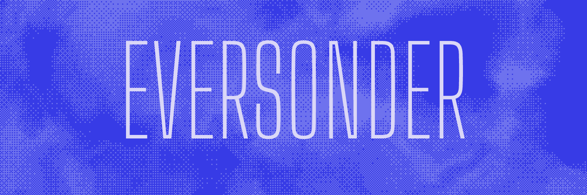

**A lab for human curiosity.** An independent lab building the foundations that let AI work for each person: safely, lastingly and on their own terms.

> The model can change. What's yours persists.

## What we're building

### [Annex](https://annex.eversonder.com)

One API for every sandbox your agents use: cheapest, fastest or nearest, on the accounts you already have. It also runs them on a Mac mini or a Raspberry Pi of your own.

- [Use cases](https://annex.eversonder.com/use-cases): twelve things to build, six with a full walkthrough
- [annex-examples](https://github.com/eversonder/annex-examples): those six as small projects you can run
- [annex-cli](https://github.com/eversonder/annex-cli): Annex from your terminal
- [annex-templates](https://github.com/eversonder/annex-templates): ready-made starting points for sandboxes
- [awesome-agent-sandboxes](https://github.com/eversonder/awesome-agent-sandboxes): every place an agent can run code, and the tools underneath
- [Providers](https://annex.eversonder.com/providers) · [Prices](https://annex.eversonder.com/sandbox-prices) · [Docs](https://annex.eversonder.com/docs)

### [Wonder](https://eversonder.com/wonder)

Voice models that run entirely on a Raspberry Pi.

- [wonder-bench](https://github.com/eversonder/wonder-bench): every number measured on a real Raspberry Pi 5

## Why

AI is becoming personal. For it to really work for people, three things have to be true:

- **It must have somewhere to work.**
- **What it makes for you must last.**
- **It must be able to live close to you.**

Read the whole [thesis](https://eversonder.com/thesis).

---

[eversonder.com](https://eversonder.com) · [X](https://x.com/eversonderAI) · [humans@eversonder.com](mailto:humans@eversonder.com) · endlessly curious
